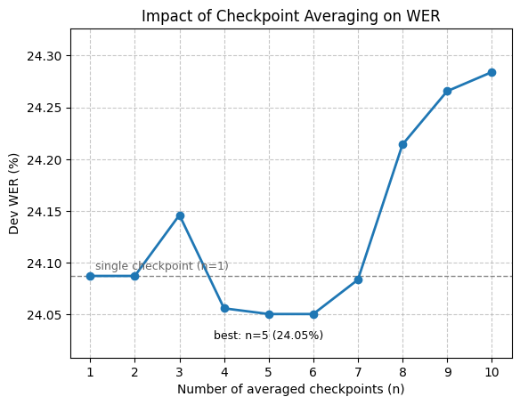

# Checkpoint Averaging Report

Weight averaging over the last n checkpoints of a single training run. The averaged weights form one regular model, so decoding cost is unchanged. n=1 is the last single checkpoint and serves as the baseline.

| n averaged | Epochs | Dev WER |
| :---: | :---: | :---: |
| 1 | 25 | 24.09% |
| 2 | 24-25 | 24.09% |
| 3 | 23-25 | 24.15% |
| 4 | 22-25 | 24.06% |
| 5 | 21-25 | 24.05% |
| 6 | 20-25 | 24.05% |
| 7 | 19-25 | 24.08% |
| 8 | 18-25 | 24.21% |
| 9 | 17-25 | 24.27% |
| 10 | 16-25 | 24.28% |

Best result: n=5 at 24.05% WER, an improvement of 0.04 points over the baseline.
