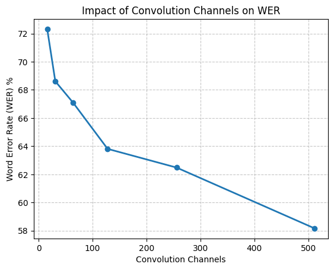
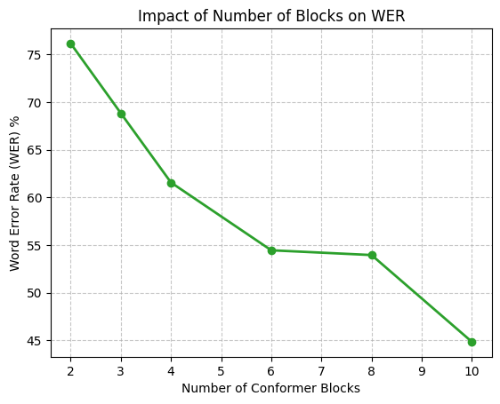
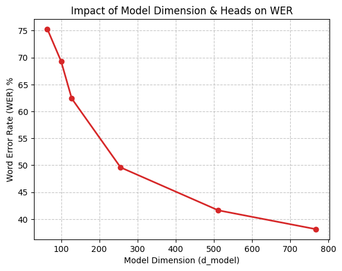
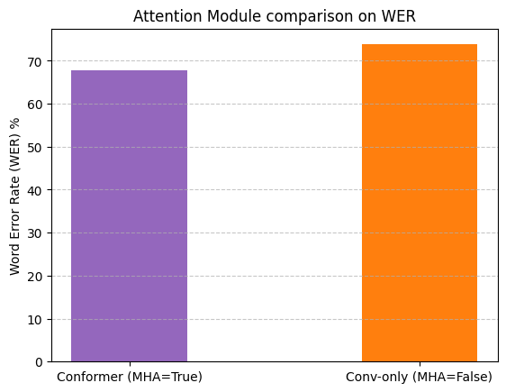
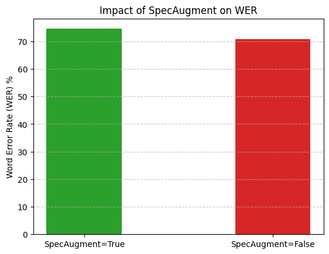
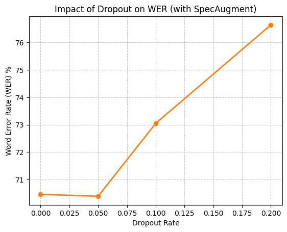
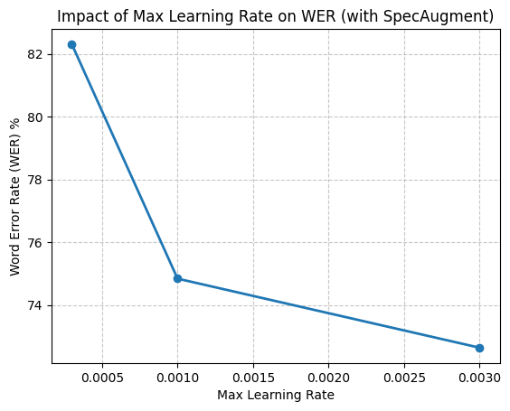
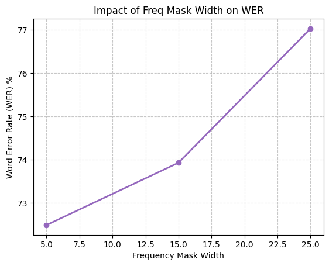
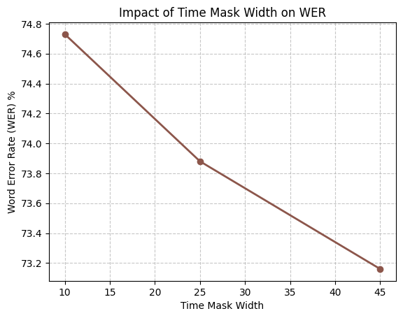

# Hyperparameter Analysis Report

This report summarizes the impact of structural model parameters on the Word Error Rate (WER) of the Conformer speech recognition system, trained for 10 epochs.

## Summary of Results

### 1. Convolution Channels
| Channels | Best Dev WER | Best Dev Loss | Run Time (s) |
| :---: | :---: | :---: | :---: |
| 16 | 72.32% | 1.8054 | 376.3 |
| 31 | 68.61% | 1.6757 | 371.1 |
| 64 | 67.09% | 1.6218 | 371.5 |
| 128 | 63.81% | 1.5071 | 374.1 |
| 256 | 62.48% | 1.4310 | 391.3 |
| 512 | 58.16% | 1.3080 | 409.5 |

---

### 2. Number of Conformer Blocks
| Blocks | Best Dev WER | Best Dev Loss | Run Time (s) |
| :---: | :---: | :---: | :---: |
| 2 | 76.16% | 1.9883 | 317.5 |
| 3 | 68.84% | 1.6719 | 370.4 |
| 4 | 61.57% | 1.4607 | 422.6 |
| 6 | 54.46% | 1.2817 | 557.5 |
| 8 | 53.96% | 1.2744 | 642.8 |
| 10 | 44.86% | 1.0224 | 762.3 |

---

### 3. Model Dimension and Attention Heads
| d_model / heads | Best Dev WER | Best Dev Loss | Run Time (s) |
| :---: | :---: | :---: | :---: |
| 64 / 2 | 75.29% | 1.9773 | 334.8 |
| 100 / 4 | 69.32% | 1.6977 | 388.9 |
| 128 / 4 | 62.38% | 1.4742 | 369.3 |
| 256 / 8 | 49.59% | 1.0965 | 481.9 |
| 512 / 8 | 41.62% | 0.9036 | 567.1 |
| 768 / 8 | 38.12% | 0.8522 | 718.9 |

---

### 4. Attention Module Comparison
| Architecture | Best Dev WER | Best Dev Loss | Run Time (s) |
| :---: | :---: | :---: | :---: |
| Conformer (MHA=True) | 67.79% | 1.6612 | 390.1 |
| Conv-Only (MHA=False) | 73.80% | 1.8884 | 278.3 |

---

### 5. SpecAugment Activation
| SpecAugment | Best Dev WER | Best Dev Loss | Run Time (s) |
| :---: | :---: | :---: | :---: |
| Enabled (True) | 74.55% | 1.9514 | 398.2 |
| Disabled (False) | 70.72% | 1.7635 | 372.8 |

---

### 6. Dropout Rate (with SpecAugment)
| Dropout | Best Dev WER | Best Dev Loss | Run Time (s) |
| :---: | :---: | :---: | :---: |
| 0.0 | 70.46% | 1.7215 | 383.1 |
| 0.05 | 70.39% | 1.7549 | 394.3 |
| 0.1 | 73.05% | 1.8719 | 390.3 |
| 0.2 | 76.64% | 2.0292 | 390.9 |

---

### 7. Max Learning Rate (with SpecAugment)
| Max LR | Best Dev WER | Best Dev Loss | Run Time (s) |
| :---: | :---: | :---: | :---: |
| 0.0003 | 82.31% | 2.5058 | 391.6 |
| 0.001 | 74.84% | 1.9830 | 389.2 |
| 0.003 | 72.64% | 1.8344 | 404.8 |

---

### 8. SpecAugment Frequency Mask Width
| Width | Best Dev WER | Best Dev Loss | Run Time (s) |
| :---: | :---: | :---: | :---: |
| 5 | 72.49% | 1.8462 | 395.0 |
| 15 | 73.93% | 1.9517 | 392.0 |
| 25 | 77.03% | 2.1100 | 392.3 |

---

### 9. SpecAugment Time Mask Width
| Width | Best Dev WER | Best Dev Loss | Run Time (s) |
| :---: | :---: | :---: | :---: |
| 10 | 74.73% | 1.9278 | 392.7 |
| 25 | 73.88% | 1.9116 | 393.3 |
| 45 | 73.16% | 1.8931 | 393.4 |

